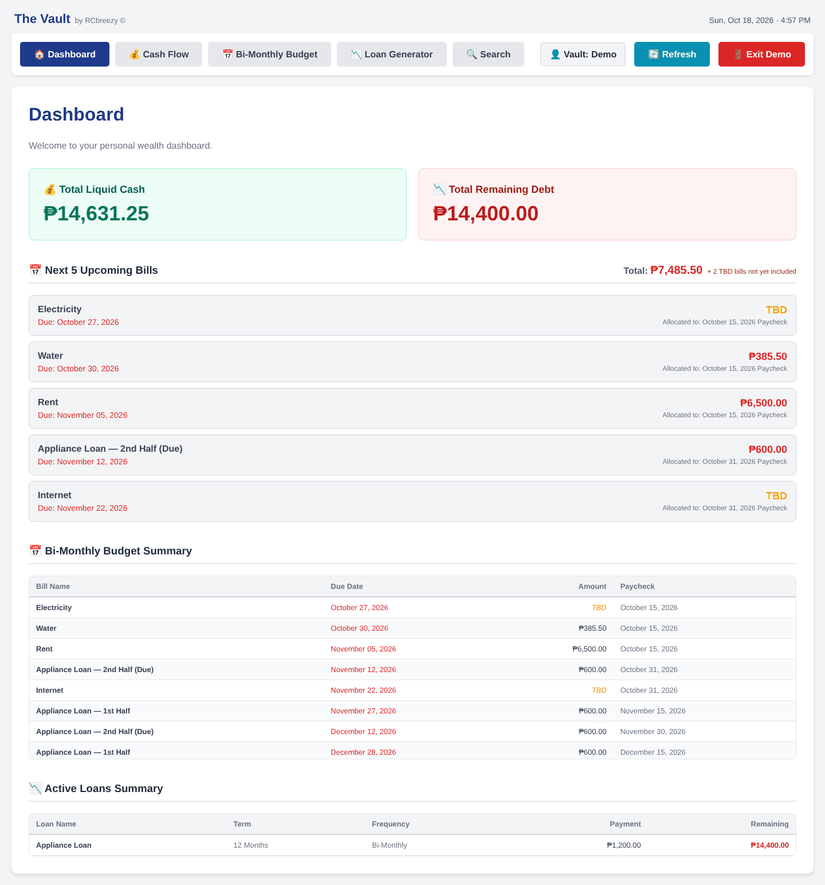
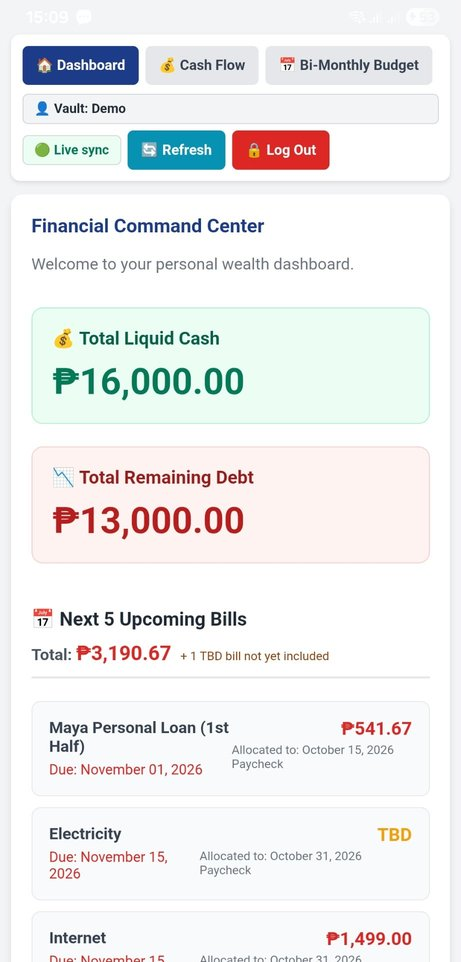
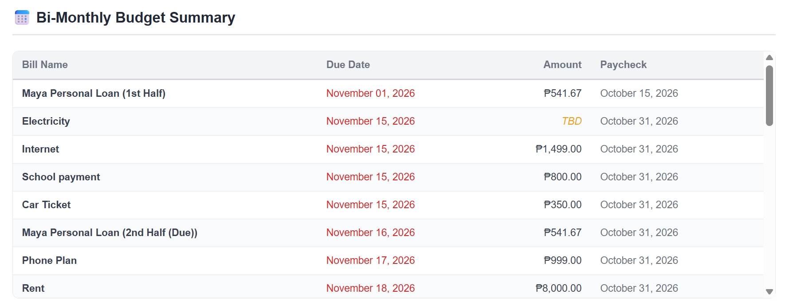
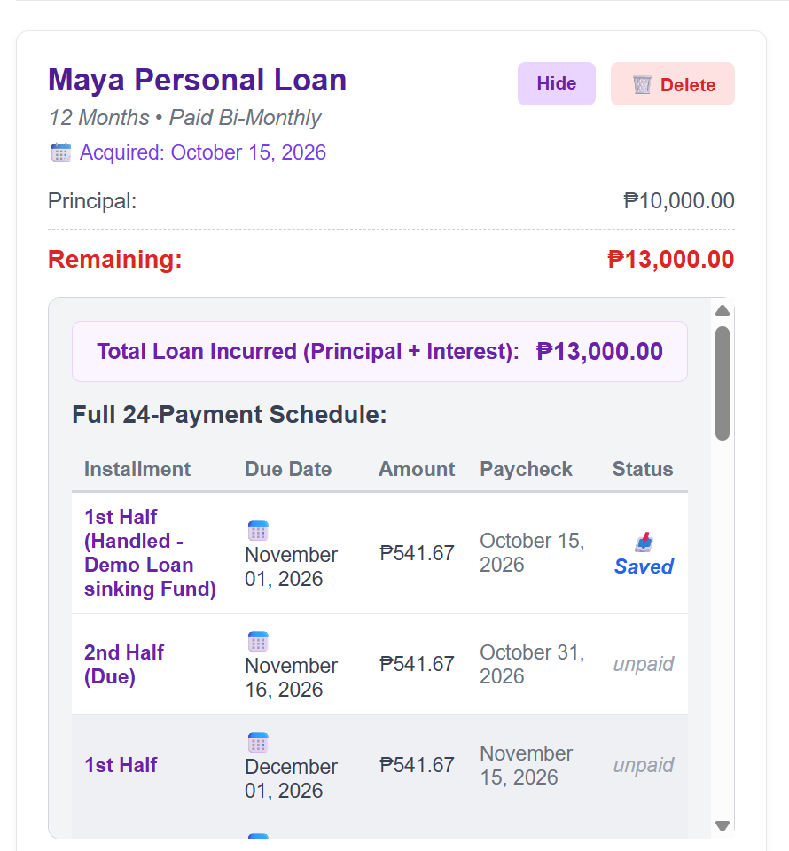

# Financial Command Center

A budgeting app for desktop and Android, built with [Tauri](https://tauri.app/), React, and Vite. Each profile gets its own SQLite "vault". By default it stays on your machine; turn on **sync** to use the same vault from your phone, updated in real time.

## Screenshots

The same demo vault on the desktop and on an Android phone, kept in step by live sync.

<p>
  
  
</p>



*Bi-Monthly Budget: every bill is assigned to the paycheck that will cover it. Electricity is still TBD, so it's flagged until the amount comes in.*



*Loan Generator: a ₱10,000 loan turned into a 24-payment bi-monthly schedule, each payment assigned to a paycheck.*

## Features

- **Dashboard**: an overview of your accounts and finances, with the total of the next 5 upcoming bills
- **Cash Flow**: track money coming in and going out, with transaction history per account or across all accounts
- **Bi-Monthly Budget**: plan spending across twice-monthly pay periods; move bills between paychecks and split recurring bills into halves
- **Loan Generator**: model debt and loan payoff, with Sinking Fund or True Bi-Monthly schedules
- **Search**: find any bill, loan, or amount
- **Smart bills**: reminders at login for recurring bills due within 10 days that still need an amount
- **Phone app + real-time sync** (optional): family members create their own accounts on a free Firebase project (no server, no card), and every change on one device shows up on their others within a second. See [Family accounts and sync](docs/SYNC_AND_MOBILE.md)

## User's Manual

New to the app? Read the [User's Manual](docs/USER_MANUAL.md), or the print-ready [PDF version](docs/Vault-User-Manual.pdf).

## Getting started

Prerequisites: [Node.js](https://nodejs.org/) and the [Tauri prerequisites](https://tauri.app/start/prerequisites/) (Rust and the WebView2 runtime on Windows).

```bash
npm install
npm run tauri dev
```

To build an installer:

```bash
npm run tauri build
```

## Running tests

```bash
npm test
```

runs the frontend tests (search, and the sync engine against real vault-core replicas). The backend tests run against throwaway databases, never your real vaults:

```bash
cd vault-core && cargo test   # the business logic shared by every app
npm run test:firebase         # sync and security rules on the Firebase emulators (needs Java)
```

## Project layout

- `src/`: the React frontend, shared by the desktop and phone apps. `src/api.js` sends each command to the local vault, or through the sync engine in `src/sync/` when signed in.
- `vault-core/`: all the business logic (accounts, bills, loans…), and the rules for applying synced changes.
- `src-tauri/`: the desktop/mobile app shell.
- `src/firebaseConfig.js` and `firestore.rules`: the optional Firebase sync setup; see [docs/SYNC_AND_MOBILE.md](docs/SYNC_AND_MOBILE.md).

## Your data

When you unlock a vault without sync, the app creates `<profile_name>_finance_data.db` in `Documents\FinancialCommandCenter\`. When you're signed in to an account, each device keeps its own copy of your vaults in the app's data folder, kept in step through Firebase (see [backups](docs/SYNC_AND_MOBILE.md#backups)). These files hold your personal financial data and live outside the repo, so back that folder up separately. `.gitignore` also excludes any stray `*.db` files so they are never committed.

## Recommended IDE setup

- [VS Code](https://code.visualstudio.com/) + [Tauri](https://marketplace.visualstudio.com/items?itemName=tauri-apps.tauri-vscode) + [rust-analyzer](https://marketplace.visualstudio.com/items?itemName=rust-lang.rust-analyzer)
